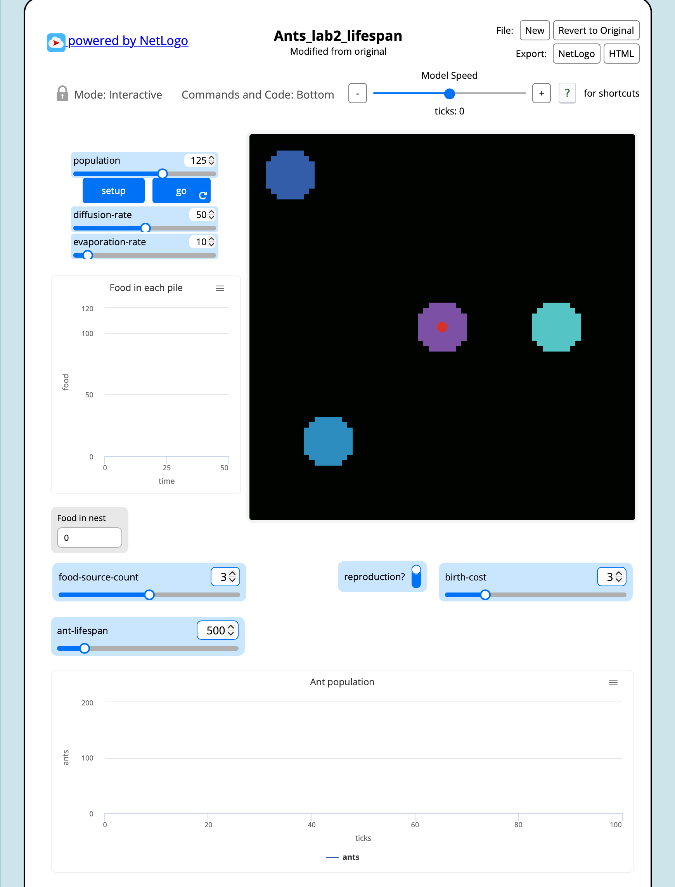
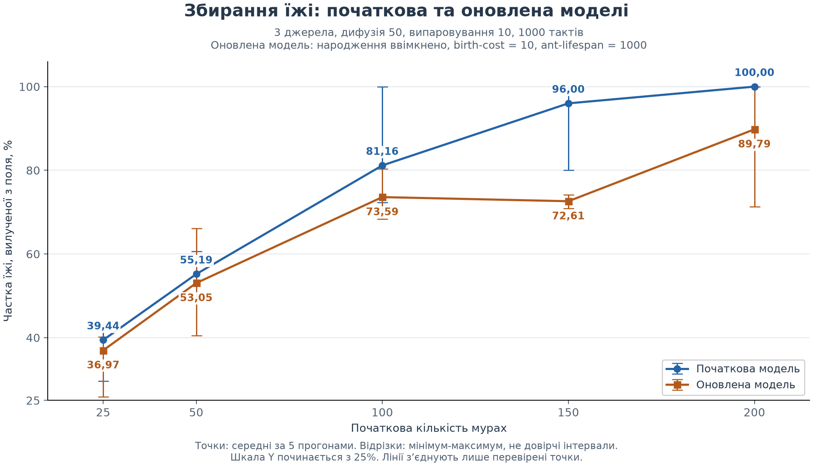
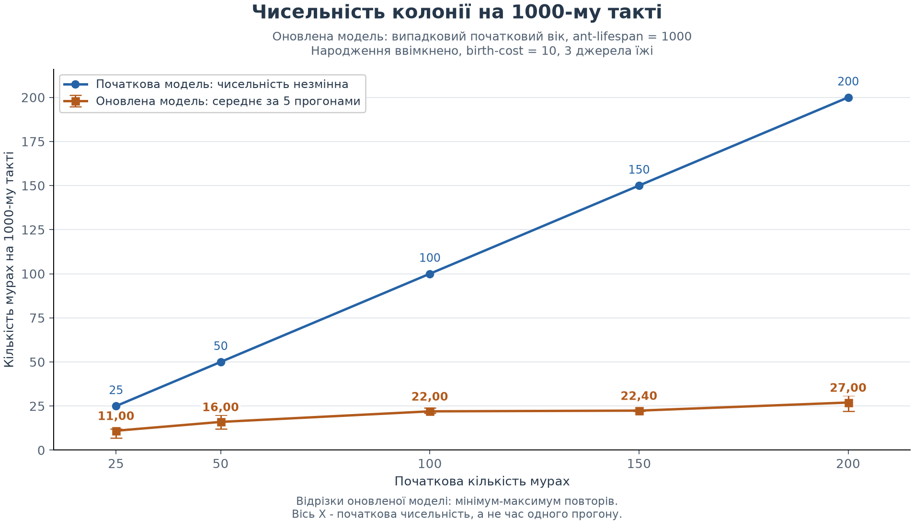

# Комп’ютерні системи імітаційного моделювання

## СПм-25-1, Нечітайло Олександр Віталійович

### Лабораторна робота №2. Редагування імітаційних моделей у середовищі NetLogo

**Варіант 10 - Ants.**

[Опис початкової моделі](https://ccl.northwestern.edu/netlogo/models/Ants) · [Змінена модель](Ants_lab2.nlogox) · [Первинні результати](results.md)

## Мета роботи

Ознайомитися із синтаксисом NetLogo та внести зміни до готової моделі Ants. Додати керування джерелами їжі, облік запасу гнізда, народження мурах і графік чисельності. Як власну зміну реалізувати старіння, загибель та залишення вантажу на полі. Порівняти залежність збирання їжі від початкової чисельності колонії до і після змін.

## Зміни за варіантом

### 1. Керування кількістю джерел їжі

Додано повзунок `food-source-count`: від 0 до 6, крок 1. У `setup-food` перелічено шість можливих центрів: `[21 0]`, `[-21 -21]`, `[-28 28]`, `[21 21]`, `[0 -28]`, `[-21 0]`. Перші три відповідають початковій моделі за стандартних меж світу від -35 до 35.

Процедура виконується для кожної клітинки. Цикл `while` перебирає перші `food-source-count` центрів. Команда `item` отримує координати зі списку; нумерація починається з 0. Клітинки на відстані меншій за 5 отримують номер джерела та випадково 1 або 2 одиниці їжі. За значення 0 початкових джерел немає. Зміна кількості застосовується під час нового `setup`.

```netlogo
let source-position item i positions  ;; retrieves the coordinates of the current source

if (distancexy (item 0 source-position)
               (item 1 source-position)) < 5
[
  set food-source-number i + 1
]
```

У `recolor-patch` додано жовтий, рожевий та помаранчевий кольори для джерел 4, 5 і 6. На графік `Food in each pile` додано відповідні пера.

### 2. Запас їжі у гнізді

Оголошено глобальну змінну `food-in-nest`, яка обнуляється під час `setup`. Її значення показує елемент Monitor з нульовою кількістю десяткових знаків.

Їжа зараховується у `return-to-nest`, коли мураха з вантажем перебуває на клітинці гнізда:

```netlogo
ifelse nest?
[
  set food-in-nest food-in-nest + 1  ;; adds the delivered unit to the nest reserve
  set color red  ;; returns the ant to the searching state
  rt 180
]
```

Після доставки мураха стає червоною й більше не виконує цю гілку як носій того самого вантажу. Поточний запас гнізда не тотожний загальній кількості колись доставленої їжі, оскільки частина запасу витрачається на народження.

### 3. Вимикана поява нових мурах

Додано перемикач `reproduction?` та повзунок `birth-cost`. Коли перемикач увімкнений і запас не менший за вартість народження, процедура `reproduce-ants` витрачає цю кількість їжі та створює одного агента у центрі гнізда. За один такт створюється не більше однієї мурахи.

```netlogo
if reproduction? and (food-in-nest >= birth-cost)
[
  set food-in-nest food-in-nest - birth-cost  ;; spends food on one new ant

  create-turtles 1
  [
    setxy 0 0  ;; places the new ant in the nest
    set size 2
    set color red  ;; the new ant starts without food
    set activation-tick ticks + 1  ;; starts moving on the next tick
    set age 0  ;; newborn ants begin with zero age
  ]
]
```

Вимкнення перемикача припиняє нові народження, але не видаляє вже створених агентів. Стать, матка та стадії розвитку окремо не моделюються: це спрощене правило поповнення робочої колонії за рахунок спільного ресурсу.

Для початку руху введено індивідуальну змінну `activation-tick`. Початкові мурахи отримують `who + 1`, зберігаючи поступовий вихід; новонароджені - `ticks + 1`. Старе правило `who >= ticks` замінено на `ticks < activation-tick`, оскільки унікальний номер агента не є часом його народження.

### 4. Графік чисельності колонії

Додано графік `Ant population` з одним пером `ants`. Команда оновлення пера:

```netlogo
plotxy ticks count turtles  ;; plots the colony size at the current tick
```

`population` задає початкову кількість, а `count turtles` повертає фактичну поточну чисельність. Графік оновлюється при `reset-ticks` і `tick`. Без народження та загибелі він горизонтальний; у зміненій моделі може зростати й спадати.

## Власна зміна: старіння, загибель і повернення вантажу

До `turtles-own` додано `age`. Повзунок `ant-lifespan` задає спільну межу життя. Під час `setup` початковий вік має рівномірний випадковий розподіл:

```netlogo
set age random ant-lifespan  ;; assigns a random initial age below the lifespan limit
```

Наприклад, за межі 1000 можливі віки від 0 до 999. Новонароджені отримують 0. Різні початкові віки усувають штучну одночасну загибель всієї початкової колонії. Рівномірний розподіл є припущенням моделі, а не виміряним віковим складом реальних мурах.

```netlogo
to age-and-die  ;; turtle procedure
  set age age + 1  ;; completes one tick of this ant's life

  if age >= ant-lifespan
  [
    if color = orange + 1
    [
      ask patch-here
      [
        set food food + 1  ;; returns the carried unit without replacing existing food
        recolor-patch  ;; makes the dropped food visible immediately
      ]
    ]

    die  ;; removes the ant after its carried food has been returned
  ]
end
```

Мураха збільшує вік на одиницю; досягнувши межі, залишає вантаж на поточній клітинці й виконує `die`. Колір `orange + 1` позначає носія однієї одиниці їжі. Додавання `food + 1` зберігає вже наявний запас клітинки. Агент без вантажу їжі не створює.

Нова клітинка сітки не створюється: змінюється `food` на наявній `patch-here`. Поза початковими джерелами така їжа показується білим кольором; на клітинці джерела залишається колір цього джерела. Їжа має пріоритет відображення також на клітинках гнізда. Початкова процедура `look-for-food` уже перевіряє `food > 0`, тому інша мураха може підібрати залишений вантаж без окремого алгоритму пошуку. Додаткове перо `food-outside-sources` показує запас на клітинках із `food-source-number = 0`.

### Порядок одного такту

1. Активні мурахи шукають або переносять їжу та рухаються.
2. Усі наявні мурахи виконують `age-and-die`, включно з тими, які ще очікують виходу.
3. Виконується `reproduce-ants`. Новонароджені не старіють у такт своєї появи.
4. Феромон дифундує та випаровується, кольори клітинок оновлюються.
5. `tick` збільшує час і оновлює графіки.

Час очікування виходу враховується у віці. Тому частина достатньо старих початкових агентів може загинути, ще не розпочавши рух. Це також впливає на результат при зміні початкової чисельності.

### Перевірка працездатності

Перевірено створення вибраної кількості джерел, зарахування їжі після доставки, обнулення запасу під час `setup`, перемикання народження та роботу графіка чисельності. Контрольні перевірки старіння підтвердили, що вантаж додається до вже наявної їжі, може бути підібраний іншою мурахою, а загибель порожнього агента не створює ресурсу. Новонароджені починають із віком 0. Контрольні перевірки коду не включено до експериментальних таблиць.



## Обчислювальний експеримент

### Вплив початкової чисельності на збирання їжі до і після змін

Досліджено початкові популяції 25, 50, 100, 150 і 200 мурах. Для кожного значення виконано п’ять прогонів оновленої моделі по 1000 тактів. Для порівняння повторно використано 25 відповідних прогонів початкової моделі з лабораторної №1.

**Постійні умови:**

| Параметр | Значення |
|---|---:|
| Кількість джерел | 3 |
| Розташування джерел | Перші три стандартні центри |
| `diffusion-rate` | 50 |
| `evaporation-rate` | 10 |
| Тривалість | 1000 ticks |
| Повторів на значення | 5 |
| `reproduction?` в оновленій моделі | true |
| `birth-cost` в оновленій моделі | 10 |
| `ant-lifespan` в оновленій моделі | 1000 |
| Початковий вік в оновленій моделі | Випадковий від 0 до 999 |

У початковій моделі народження та загибель відсутні. Перед кожним прогоном виконувалося `setup`. Початкові запаси їжі, траєкторії та віки містять випадковість; `random-seed` не фіксувався. Прогони двох версій не є парними за однаковими випадковими станами. Експеримент порівнює сукупність внесених змін, а не ізольований ефект старіння.

Основний показник - **частка початкової їжі, яка до 1000-го такту вилучена з поля**:

$$
P_{1000}=\frac{F_0-F_{1000}}{F_0}\cdot100\%.
$$

Тут **F₀** - початкова сума `food` за всіма клітинками, **F₁₀₀₀** - така сама сума наприкінці прогону. Залишок враховує їжу і на початкових джерелах, і на клітинках, де загинули носії. Завдяки цьому залишений вантаж не зараховується як зібраний. У початковій моделі вся їжа на полі була у джерелах, тому показник узгоджується з використаним у лабораторній №1.

Вилучена їжа може бути у вантажі живих мурах, у гнізді або вже витраченою на народження. Тому цей показник не слід називати поточним запасом гнізда чи лише доставленою їжею. Додатково записувалися `count turtles` і `food-in-nest` на 1000-му такті. Середні обчислено з неокруглених часток кожного прогону.

### Частка вилученої їжі

| Початкова кількість | Початкова модель, % | Оновлена модель, % | Різниця, в. п. | Діапазон оновленої, % |
|---:|---:|---:|---:|---:|
| 25 | 39,44 | 36,97 | -2,46 | 25,83-40,19 |
| 50 | 55,19 | 53,05 | -2,14 | 40,53-66,13 |
| 100 | 81,16 | 73,59 | -7,57 | 68,37-80,32 |
| 150 | 96,00 | 72,61 | -23,39 | 70,94-74,13 |
| 200 | 100,00 | 89,79 | -10,21 | 71,25-100,00 |

Різниця обчислена як середнє оновленої моделі мінус середнє початкової, у відсоткових пунктах.



На графіку показано середні та діапазони мінімум-максимум п’яти повторів. Ці відрізки не є довірчими інтервалами. Шкала Y починається з 25%, усі індивідуальні результати входять у її межі. Лінії лише з’єднують перевірені значення параметра.

За 25 і 50 мурах середні двох моделей відрізнялися приблизно на 2-2,5 відсоткового пункта при значному розкиді повторів. За 100 середнє оновленої моделі було нижчим на 7,57 пункта, за 150 - на 23,39, за 200 - на 10,21. Між 100 і 150 початковими мурахами середній результат оновленої моделі майже не змінився, а за 200 знову зріс до 89,79%.

У початковій моделі за 200 мурах усі п’ять прогонів дали 100%. В оновленій два прогони дали 100%, один - 99,68%, ще два - 78% і 71,25%. Отже, однаковий високий результат у цій серії не відтворювався стабільно.

### Кінцева чисельність та запас гнізда

| Початкова кількість | Середня кінцева чисельність | Мінімум-максимум | Середній запас у гнізді |
|---:|---:|---:|---:|
| 25 | 11,00 | 7-12 | 3,80 |
| 50 | 16,00 | 12-20 | 5,20 |
| 100 | 22,00 | 21-24 | 5,60 |
| 150 | 22,40 | 22-23 | 4,20 |
| 200 | 27,00 | 22-31 | 5,60 |



У початковій моделі чисельність незмінна протягом прогону. В оновленій усі кінцеві популяції були меншими за початкові: на 1000-му такті залишалося від 7 до 31 мурахи. Народження не компенсувало загибелі, проте повного вимирання колоній у цих 25 прогонах не спостерігалося.

За межі життя 1000 усі початкові мурахи до моменту підсумкового вимірювання вже загинули. Новонароджені ще не досягли цієї межі, тому кінцева чисельність визначається народженнями протягом прогону. Вона тісно пов’язана з доставленою їжею та її вартістю, а не є незалежним від збирання показником.

Наприклад, у першому прогоні за 25 мурах вилучено 126 одиниць їжі. За правилами моделі 120 одиниць витрачено на 12 народжень, 5 залишилося у гнізді, а ще 1 перебувала у вантажі. Останнє значення виведено з балансу ресурсу, а не виміряно окремим лічильником.

### Висновок експерименту

За невеликої початкової популяції навіть початкова модель не вилучала всю їжу за заданий час. Після змін колонія поступово втрачала початкових працівників, а народження за рахунок запасу їжі не компенсувало загибелі. Зменшення кількості пошуковців і носіїв може ускладнювати знаходження джерел, перенесення їжі та підкріплення стежок. Таке пояснення узгоджується зі зниженням середньої частки вилученої їжі в отриманих серіях.

Середні результати оновленої моделі нижчі в усіх п’яти досліджених точках, а залежність стала менш рівномірно зростаючою. Найбільша різниця середніх спостерігалася за 150 мурах. Водночас експеримент не дозволяє кількісно відокремити внесок народження, старіння, випадкового віку та повернення вантажу, оскільки ці механізми змінено разом. Статистична значущість різниць окремо не перевірялася.

## Загальні висновки

Внесено всі зміни за варіантом: налаштування кількості джерел, облік запасу гнізда, вимикане народження за достатньої кількості їжі та графік чисельності. Власна зміна додала вік, обмежене життя та повернення вантажу на поле перед загибеллю. Випадковий початковий вік дозволяє уникнути одночасної загибелі всієї початкової колонії.

Опрацьовано глобальні та індивідуальні змінні, списки, цикл `while`, вибір клітинок, `ask`, створення й видалення агентів, умови та оновлення графіків. Нові правила поєднано з початковим алгоритмом пошуку й перенесення їжі.

Обчислювальний експеримент показав, що за обраних налаштувань середній результат після змін нижчий, а чисельність колонії скорочується попри народження. Висновки стосуються перевірених параметрів і 1000 тактів; кінцева чисельність не є оцінкою довготривалої рівноваги. Розподіл віку, витрати на народження та межа життя є спрощеними припущеннями моделі, які не калібрувалися за реальними колоніями.
